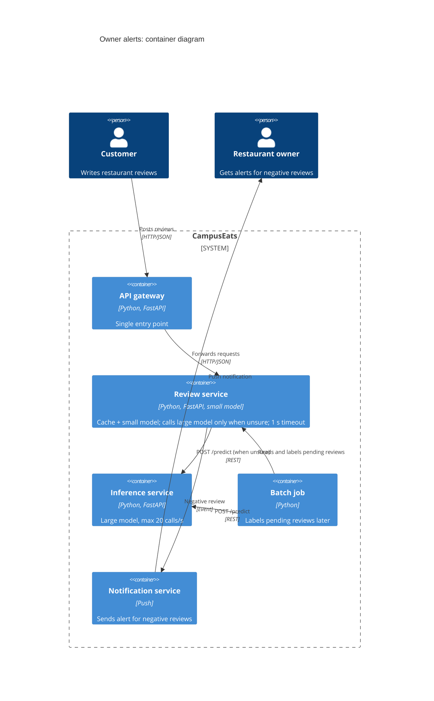

# Task 4: Deployment topologies and trade-offs

**Name:** Kanokjan Singhsuwan

**Student ID:** 01223046

This is **individual work**: each student completes and submits their own copy, in their own fork.

Design a deployment for the scenario below. Use your measurements from Tasks 0–3 as evidence: cite run names from `results/runs.csv`. Answer in English.

## Scenario: Owner alerts

When a customer posts a negative review, the restaurant owner gets a push notification within **2 seconds**. At the lunch peak, CampusEats receives **40 reviews per second**. A missed alert is acceptable, but a wrong alert (for example, "your customer is unhappy" when they are happy) makes owners stop trusting alerts and, in the end, ignore them.

Facts:

- The large model serves at most **20 calls per second** (4 calls at once × about 200 ms each), and every call costs money.
- The small model is fast and cheap enough to run anywhere, including inside the review service, but it is much less accurate on its own.

## Topologies and patterns to choose from

| | Topology | Where the model runs |
|---|---|---|
| T1 | Model as a service, synchronous | Inference service, called for each review (today's baseline) |
| T2 | Model as a library | Inside the review service, or on the device |
| T3 | Hybrid | Small model locally, large model as a remote service |
| T4 | Asynchronous / batch | Reviews are queued or stored, and scored later in bulk |

Combine one topology with any of the patterns from Tasks 1–3: **fallback**, **cascade** and **cache**.

## 1. Quality requirements

The three most important quality requirements for this scenario, each with a number where possible.

| # | Quality | Requirement |
|---|---|---|
| 1 | Latency | Owner gets the alert within **2 s** (p95) |
| 2 | Correctness | Few wrong alerts: accuracy **≥ 93%**. If the system isn't sure, it doesn't alert |
| 3 | Capacity / cost | Handle **40 reviews/s** at peak with **≤ 20 large-model calls/s** |

## 2. Design

**Topology:** T3 Hybrid. The small model runs inside the review service, and the large model is a remote service.

**Patterns:**
- **Cache:** check the cache first.
- **Cascade (threshold 0.7):** if the small model is confident, use its answer. If not, call the large model.
- **Fallback (1 s timeout):** if the large model is slow or fails, save the review as `pending` and send **no alert**. A batch job labels it later.

## 3. Evidence

Which runs support your choice? Show the numbers and the capacity arithmetic: how many large-model calls per second does your design need at the peak?

| Run | What it shows |
|---|---|
| t0-large | Large model only: 100% large calls → 40 calls/s, **twice the 20/s limit** |
| t2-0.8 | 93.5% accuracy but 64% large calls → 25.6 calls/s, **still too many** |
| t3-cache | Cascade 0.7 + cache: 93.0% accuracy, p95 535 ms, **38% large calls** |
| t1-after | Timeout keeps the system fast when the model hangs (0 errors, pending instead) |

**Capacity:** 40 reviews/s × 38% = **15.2 large calls/s**, which is under the 20/s limit. p95 is 535 ms, which is under 2 s.

## 4. ADR

An **architecture decision record (ADR)** is a short document that records one design decision: the situation that forced it (context), what you decided, and what follows from it, good and bad (consequences). Fill in the template below.

**Title:** Hybrid deployment with cache, cascade and fallback for owner alerts

**Status:** Proposed

**Context:** Owners need an alert within 2 s. The peak is 40 reviews/s, but the large model handles only 20 calls/s. Wrong alerts make owners stop trusting the alerts, but a missed alert is OK.

**Decision:** Run the small model and the cache inside the review service (T3 Hybrid). Use a cascade with threshold 0.7. Use a 1 s timeout on the large model, and save timed-out reviews as pending without alerting.

**Consequences:**
- Positive: 15.2 large calls/s fits the limit; p95 535 ms meets the 2 s goal; costs about 60% less than large-only.
- Negative: accuracy drops slightly (93.0% vs 93.5%); pending reviews get no alert; the small model can be confidently wrong (e.g., sarcasm).

**Alternatives considered:** at least one topology you rejected, and why.

> - **T1 (large model for every review):** needs 40 calls/s, twice the limit.
> - **T4 (batch only):** too slow for a 2 s alert.
> - **T2 (small model only):** 72.5% accuracy (`t0-small`), which means too many wrong alerts.
